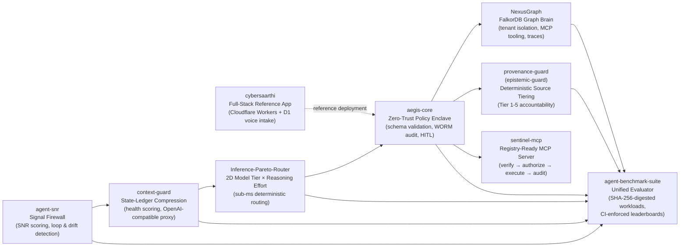

# Sandeep Hipparagi
### AI Systems Architect · Founder, BluePatterns AI
### Deterministic Control Planes · Provenance & Security Enclaves · Inference Routing · Full-Stack AI

  
  
  
  
  

---

> *"The real advantage in AI is not just the model. It is the architecture around it."*

I build the **deterministic layer around probabilistic models**: context firewalls that measure signal-to-noise, provenance enclaves that verify before trusting, routers that allocate reasoning like a budget, and zero-trust policy gates that fail closed — every claim in this portfolio backed by tests, strict type checking, and CI-enforced reproducible benchmarks.

---

## Architecture & Ecosystem Map

The flagship stack composes into one governed inference pipeline:

Every infrastructure layer is measured by [`agent-benchmark-suite`](https://github.com/Sandeep-Hipparagi/agent-benchmark-suite): seeded workloads, SHA-256 digests, and leaderboards that CI re-verifies at ≤ 3% drift.

---

## Flagship Systems Matrix

| Repository | Domain | Key engineering / security invariant | Verification status |
| :--- | :--- | :--- | :--- |
| **[agent-snr](https://github.com/Sandeep-Hipparagi/agent-snr)** · PyPI | Agentic context firewall | SNR-scored pruning; loop-entropy & goal-drift circuit breakers; zero-dep decision path | 108/108 tests · mypy strict · 163 fuzz probes, 0 crashes |
| **[context-guard](https://github.com/Sandeep-Hipparagi/context-guard)** · PyPI | Context compression proxy | State-ledger compression; credential-free CORS; non-root containers | 41/41 tests · ruff + format clean |
| **[Inference-Pareto-Router](https://github.com/Sandeep-Hipparagi/Inference-Pareto-Router)** · PyPI | Inference routing | 2D `(tier, effort)` frontier; no network in decision path | 48/48 tests · mypy `--strict` · 214 fuzz probes, 0 crashes |
| **[aegis-core](https://github.com/Sandeep-Hipparagi/aegis-core)** | Zero-trust policy enclave | Fail-closed schema validation; WORM audit ledger; HITL gates; non-root containers | 73 TS + 15 Python tests · SEC-01…09 adversarial suite |
| **[epistemic-guard](https://github.com/Sandeep-Hipparagi/epistemic-guard)** (`provenance-guard` on PyPI) | Provenance verification | Deterministic Tier 1–5 source accountability; zero-hallucination `DO_NOT_SHARE_UNCONFIRMED` invariant | 89/89 tests · MCP 1.x/2.x dual support |
| **[NexusGraph](https://github.com/Sandeep-Hipparagi/NexusGraph)** | Graph memory & multi-agent state | Tenant-isolated FalkorDB graphs; injection-hardened identifiers; digest-pinned CI | 38/38 tests incl. live-FalkorDB integration |
| **[agent-benchmark-suite](https://github.com/Sandeep-Hipparagi/agent-benchmark-suite)** | Unified evaluation | SHA-256 workload digests; CI drift gate ≤ 3%; byte-stable leaderboards; **native mode executes the real flagship libraries** (aegis-core compiled dist via Node, in-process Python adapters) | 85/85 tests · mypy strict · CI green |
| **[sentinel-mcp](https://github.com/Sandeep-Hipparagi/sentinel-mcp)** | Registry-ready MCP server | Merkle-chained WORM audit (100% tamper detection); fail-closed policy gate; FalkorDB→SQLite fallback | 76/76 tests · 12/12 conformance · p95 0.014 ms · CI green |
| **[cybersaarthi](https://github.com/Sandeep-Hipparagi/cybersaarthi)** | Full-stack AI application | Drizzle-parameterized D1 persistence; WebCrypto-signed sessions; contract-verified 15↔19 API map | 20/20 tests · eslint + tsc clean · 0 prod CVEs |
| **[Skipper-UI](https://github.com/Sandeep-Hipparagi/Skipper-UI)** | Motion component registry | 107 clean-room primitives; 100% local digest-verified assets | typecheck + build + asset chain green · 0 prod CVEs |

**Packages:** [`agent-snr`](https://pypi.org/project/agent-snr/) · [`provenance-guard`](https://pypi.org/project/provenance-guard/) · [`pareto-router`](https://pypi.org/project/pareto-router/) · [`context-guards`](https://pypi.org/project/context-guards/) — **Models:** [Hugging Face `Sandeep4235`](https://huggingface.co/Sandeep4235) — **Company:** [bluepatterns.ai](https://bluepatterns.ai/)

---

## Prototype → Production

<table>
<thead><tr><th>From (Prototype)</th><th>→</th><th>To (Production)</th></tr></thead>
<tbody>
<tr><td>Experimental Prompts</td><td>→</td><td>Deterministic Multi-Agent State Routing</td></tr>
<tr><td>Brittle Reasoning Flows</td><td>→</td><td>Self-Healing Loops &amp; Fallback Runtimes</td></tr>
<tr><td>Undefined Vulnerabilities</td><td>→</td><td>Zero-Trust Guardrails &amp; Provenance Enclaves</td></tr>
<tr><td>Black-box Executions</td><td>→</td><td>WORM-Auditable, HITL-Checkpointed Decisions</td></tr>
<tr><td>Unverified Benchmarks</td><td>→</td><td>CI-Enforced, Digest-Pinned Leaderboards</td></tr>
</tbody>
</table>

---

## Open-Source Models

| Model | Base / Stack | Downloads | Release |
| :--- | :--- | :--- | :--- |
| **llama3-8b-Wisdom** | Llama-3 8B · Unsloth QLoRA · GGUF | 83 | [Hugging Face](https://huggingface.co/Sandeep4235/llama3-8b-Wisdom-gguf) |
| **Qwen3-4B-PromptCraft** | Qwen3-4B · Unsloth QLoRA · GGUF | 41 | [Hugging Face](https://huggingface.co/Sandeep4235/Qwen3-4B-PromptCraft-GGUF) |
| **llama3-2-lora-wisdom** | Llama-3.2 3B · Unsloth QLoRA | 23 | [Hugging Face](https://huggingface.co/Sandeep4235/llama3-2-lora-wisdom) |
| **qwen2.5-7b-adapter** | Qwen2.5 7B · Alpaca-Cleaned LoRA | 0 | [Hugging Face](https://huggingface.co/Sandeep4235/qwen2.5-7b-adapter) |

---

## Professional Experience & Research

- **BluePatterns AI** — *AI/ML Developer & Founder* (Apr 2025 – Present) · Multi-agent inference runtimes, self-healing state graphs, enterprise LLM evals.
- **Tata Consultancy Services (TCS)** — *Senior System Engineer* (Dec 2022 – May 2025) · Enterprise Python microservices, PostgreSQL/Redis transaction pipelines.
- **NIT Tiruchirappalli** — *Engineer Intern* (2020 – 2021) · Applied machine learning and computational research.
- **IEEE Published Research**: [*Artist Based Video Recommendation System using Machine Learning*](https://ieeexplore.ieee.org/document/9544976) (ICIRCA 2021).

---

## Collaboration

- **Enterprise AI Architecture**: multi-agent orchestration, local-first inference, and production deployment.
- **AI Safety & Evals**: guardrail implementation, provenance enclaves, benchmark harness design.
- **Domain Systems**: legal-tech AI (Indic/BNS compliance), cyber fraud defense, voice-first citizen services.
